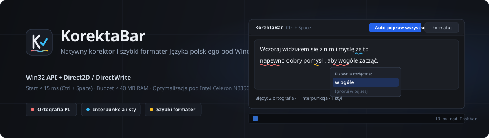

<p align="center">
  
</p>

# KorektaBar

Ultra-lekki, natywny korektor pisowni, interpunkcji, gramatyki oraz szybki formater języka polskiego dla **Windows 10**. Zaprojektowany w czystym **C++20 (Win32 API + Direct2D / DirectWrite)** z myślą o błyskawicznym wywołaniu (`< 15 ms`), pracy w zasobniku systemowym oraz niskim zużyciu pamięci i procesora na słabszych komputerach (m.in. **Intel Celeron N3350**).

---

## Najważniejsze funkcje

- **Natychmiastowy start i praca w zasobniku (`System Tray`)**: Okno pozostaje wstępnie przygotowane w pamięci, dzięki czemu po naciśnięciu **`Ctrl + Space`** pojawia się w ułamku sekundy, dokładnie **10 px nad paskiem zadań** (z pełnym skalowaniem DPI Per-Monitor V2).
- **Wygląd Dark Mode w układzie klawiatury ekranowej**: Szeroki, kompaktowy pasek roboczy dopasowany kolorystycznie do ciemnego motywu Windows 10 (grafit `#14161A`, obszar edycji `#1B1E24`).
- **Podkreślanie błędów na żywo**:
  - **Czerwone faliste podkreślenie**: ortografia, literówki, pisownia łączna/rozłączna (`wogóle → w ogóle`, `napewno → na pewno`, `wziąść → wziąć`) oraz brakujące polskie znaki diakrytyczne.
  - **Błękitne podkreślenie**: interpunkcja i gramatyka (brakujące przecinki przed spójnikami *że, żeby, aby, ponieważ, który*, zbędne przecinki przed pojedynczym *i / lub / albo*, spacje przed znakami).
  - **Bursztynowe podkreślenie**: styl, powtórzenia sąsiednie/bliskie oraz pleonazmy (*okres czasu*, *akwen wodny*, *fakt autentyczny*).
- **Menu kontekstowe pod PPM**: Kliknięcie prawym przyciskiem myszy na dowolne podkreślone słowo wyświetla przyczynę błędu, listę poprawek do podmiany jednym kliknięciem oraz opcję ignorowania w sesji.
- **Auto-popraw wszystko**: Bezpiecznie aplikuje najpewniejsze poprawki od końca tekstu (zachowując spójność indeksów UTF-16) jako jeden krok historii `Cofnij (Ctrl+Z)`.
- **Szybki formater tekstu**: Jednym kliknięciem porządkuje wielokrotne spacje, usuwa spacje przed interpunkcją, dodaje brakujące spacje po przecinkach/kropkach, normalizuje akapity i wielkie litery na początkach zdań.
- **Konfigurowalny skrót globalny i opcje**: Zmiana skrótu (`Ctrl + Space`) i przełączniki reguł zapisywane w `%APPDATA%\KorektaBar\config.ini`.

---

## Architektura i budżet zasobów (< 100 MB RAM)

| Komponent | Technologia | Szacowany ślad RAM |
| :--- | :--- | :--- |
| Rdzeń okna i edytor | Win32 API + Direct2D / DirectWrite (`IDWriteTextLayout`) | **~12–20 MB** |
| Silnik ortografii (`pl-PL`) | Systemowy Windows `ISpellChecker` + wbudowana tabela pułapek PL | **~6–12 MB** |
| Silnik interpunkcji i stylu | Natywne deterministyczne reguły C++ (bez JVM / Pythona) | **< 2 MB** |
| **Łącznie w stanie aktywnym** | Cały proces `KorektaBar.exe` | **~18–35 MB RAM** |
| **W tle (zminimalizowany)** | Zwolnienie bufora DXGI + `SetProcessWorkingSetSizeEx` | **~5–10 MB RAM** |

### Optymalizacje pod Intel Celeron N3350 (2 rdzenie / 2 wątki)
1. **Brak ciężkiej analizy przy każdym naciśnięciu klawisza**: Wątek tła wykorzystuje **300 ms *debounce*** na zdarzeniach Win32 (`WaitForMultipleObjects`), dzięki czemu szybkie pisanie nie obciąża CPU.
2. **Natychmiastowe anulowanie przestarzałych analiz**: Licznik rewizji `std::atomic<uint64_t>` przerywa analizę w tle natychmiast, gdy użytkownik dopisze kolejny znak.
3. **Jednolite indeksowanie UTF-16**: Zarówno `std::wstring`, Win32, jak i `IDWriteTextLayout` operują na jednostkach UTF-16 — brak kosztownych konwersji offsetów dla polskich znaków (`ą ć ę ł ń ó ś ź ż`).
4. **Liniowy formater $O(N)$**: Szybkie formatowanie nie używa ciężkiego `std::wregex`, wykonując porządkowanie w pojedynczych przebiegach po znakach.

---

## Skróty klawiszowe

| Skrót | Działanie |
| :--- | :--- |
| `Ctrl + Space` | Pokaż / ukryj okno KorektaBar (domyślny skrót globalny) |
| `Esc` | Ukryj okno do zasobnika systemowego |
| `Ctrl + Z` / `Ctrl + Y` | Cofnij / Ponów zmianę (stos do 100 kroków) |
| `Ctrl + A` / `C` / `X` / `V` | Zaznacz / Kopiuj / Wytnij / Wklej |
| `PPM` na podkreśleniu | Wyjaśnienie błędu i szybka podmiana sugestią |

---

## Budowanie w MSYS2 (Windows 10)

Zainstaluj środowisko [MSYS2](https://www.msys2.org/) i otwórz terminal **MSYS2 UCRT64**:

```bash
# 1. Instalacja kompilatora i narzędzi (jednorazowo)
pacman -Syu --noconfirm
pacman -S --needed --noconfirm \
  mingw-w64-ucrt-x86_64-gcc \
  mingw-w64-ucrt-x86_64-cmake \
  mingw-w64-ucrt-x86_64-ninja \
  mingw-w64-ucrt-x86_64-python \
  make

# 2. (Opcjonalnie) Regeneracja ikony KorektaBar.ico
python3 scripts/generate_assets.py

# 3. Kompilacja statycznej binarki KorektaBar.exe przez Makefile
make -C native -j$(nproc)
```

Gotowy plik wykonywalny (bez zewnętrznych zależności DLL) powstanie w `native/build/KorektaBar.exe`.

### Alternatywnie przez CMake + Ninja (MSYS2 UCRT64)

```bash
cmake -S native -B native/build-cmake -G Ninja -DCMAKE_BUILD_TYPE=Release
cmake --build native/build-cmake
```

---

## Automatyczne wydania (GitHub Releases)

Repozytorium zawiera konfigurację **GitHub Actions** (`.github/workflows/release.yml`), która po wypchnięciu taga wersji (np. `git tag v1.0.0 && git push origin v1.0.0`) automatycznie:
1. Konfiguruje środowisko `MSYS2 UCRT64` na runnerze `windows-latest`.
2. Generuje zasoby i kompiluje statyczne `KorektaBar.exe`.
3. Pakuje gotową paczkę `KorektaBar-win64.zip` i publikuje ją w sekcji **GitHub Releases**.
